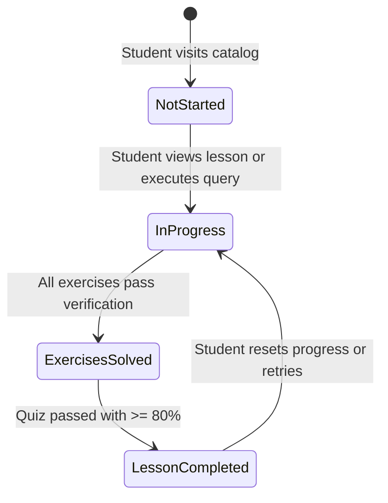

# QueryPath — Progress Tracking & Analytics Engine

## 1. Core Principles

1. **Authentic Data Only**: No simulated completion metrics, fake streaks, or unearned congratulatory badges.
2. **Deterministic Completion Rules**:
   - A lesson is marked **Completed** if and only if:
     - All of its exercises have been executed and passed by the verification engine.
     - The lesson's knowledge quiz has been taken with a passing score of at least 80% (4 out of 5 questions correct).
3. **Local Storage Privacy**: Progress is stored exclusively on the user's browser via IndexedDB.

---

## 2. Calculated Metrics

The dashboard and progress screens compute stats dynamically from IndexedDB records:

### Overall Course Completion
$$\text{Progress \%} = \frac{\text{Completed Lessons}}{\text{Total Published Lessons (2)}} \times 100$$

### Exercises Solved
$$\text{Solved Ratio} = \frac{\sum \text{Solved Exercises}}{\sum \text{Total Exercises Across Lessons (5)}} \times 100$$

### Real Study Streak Calculation
1. Fetch all unique activity dates from `exercise_attempts.lastExecutedAt`, `quiz_attempts.completedAt`, and `lessons_progress.lastAccessedAt`.
2. Convert dates to `YYYY-MM-DD` in local browser timezone.
3. Determine if today or yesterday contains an activity:
   - If not, current streak = 0.
   - If yes, count continuous consecutive days backward.

---

## 3. Progress State Transitions

---

## 4. Reset & Data Management

- **Reset Single Lesson Progress**: Clears attempts and quiz score for a specific lesson without erasing notes or bookmarks.
- **Full Factory Reset**: Clears all IndexedDB object stores (`lessons_progress`, `exercise_attempts`, `quiz_attempts`, `notes`, `bookmarks`) after explicit modal confirmation.
- **Export Progress**: Generates an encrypted/plain JSON file for personal backup.
- **Import Progress**: Validates and restores progress records with safety checks against schema corruption.
