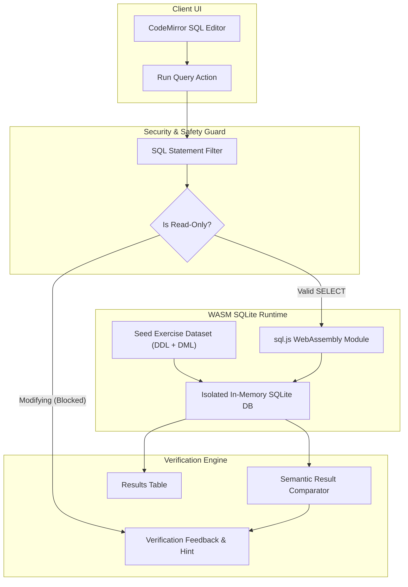

# Learn by Ceeras — Project Context & Persistent Source of Truth

> **Platform Name**: Learn by Ceeras  
> **Brand Typography**: Raleway (`font-raleway`) with "LEARN" at top and "by Ceeras" as sub-tagline  
> **Color Palette**: Ceeras Deep Teal (`#0E5E77`), Cyan Accent (`#008D9B`), and soothing slate neutrals  
> **Tagline**: Learn SQL. Practise freely. Build real skills.  
> **Short Description**: Master SQL step by step with interactive lessons, real-time query execution, instant feedback, quizzes, and offline learning.  
> **Configurable Brand Constant**: `src/lib/constants.ts` (`APP_NAME = 'Learn by Ceeras'`)

---

## 1. Project Purpose & Target Audience

QueryPath is a zero-tracking, offline-first, client-side interactive SQL learning platform designed to teach relational database fundamentals to beginners, university students, self-taught engineers, and professionals. 

Unlike platforms that rely on remote server sandboxes or visual simulators, QueryPath runs an authentic SQLite engine directly inside the browser using WebAssembly (`sql.js`). All queries, datasets, exercises, notes, bookmarks, and quiz progress remain 100% private and execute locally on the user's device.

### Non-Negotiable Requirements
1. **Zero Server Dependency for Learning**: No query, code sample, or quiz answer is ever sent to a remote API or server.
2. **Authentic SQL Execution**: Never evaluate SQL with regular expression shortcuts, mock outputs, or JavaScript `eval()`. Queries must execute in an isolated SQLite engine.
3. **Safe Read-Only Student Environment**: The student query editor safely allows data queries (e.g., `SELECT`, `EXPLAIN`, expressions) while blocking data modification statements (`INSERT`, `UPDATE`, `DELETE`, `DROP`, `ALTER`, `CREATE`) during read-only lessons unless specifically sandboxed in future exercises.
4. **No Emojis Anywhere**: Strict design rule prohibiting emojis throughout the UI, instructional content, notifications, or icons. Visual accents use clean typography and Lucide React icons.
5. **No Fake Gamification**: All metrics (completion percentage, streak, exercises completed, quiz scores) are derived strictly from local activity logs. No synthetic numbers or fake testimonials.
6. **Triple Theme Architecture**: Soft Light (default), Warm Paper, and Soft Dark. Themes switch instantaneously without page refresh and persist in IndexedDB.
7. **Complete Offline Availability**: After the first load and asset caching via the Service Worker, the entire app, including SQL WebAssembly execution, operates without an internet connection.
8. **Original Content & Zero Plagiarism**: Distinct datasets (`LibraryBooks`, `CourseCatalog`), original text, and bespoke visual layout. Absolutely no SQLBolt or third-party proprietary materials are used.
9. **Strict Foundation Scope**: Exactly two comprehensive lessons for the foundation release:
   - **Lesson 1**: *Introduction to SQL and Relational Databases*
   - **Lesson 2**: *Your First SQL Queries*
   - Plus a comprehensive multi-lesson Review Test and Freeform Practice Playground.

---

## 2. Technology Stack & Architectural Rationale

| Layer | Technology | Version | Rationale |
|---|---|---|---|
| Framework | **React** + **TypeScript** | ^18.3.1 / ^19.0.0 & ^5.6 | Strict type safety for lesson definitions, query results, and storage models. |
| Build Tool | **Vite** | ^6.0.0 | Fast HMR, optimized static assets, native WebAssembly loading support. |
| Styling | **Tailwind CSS** | ^3.4.17 | Token-driven theme engine with CSS variables for dynamic palette switching. |
| Routing | **React Router DOM** | ^6.28.0 | Clean client-side routing, deep linking, nested layout shell, history navigation. |
| SQL Engine | **SQL.js (WebAssembly SQLite)** | ^1.12.0 | Full native SQLite compiled to WASM. Completely offline and isolated. |
| Code Editor | **CodeMirror 6** (`@uiw/react-codemirror`, `@codemirror/lang-sql`) | Latest | High accessibility, syntax highlighting, keyboard navigation, line numbering. |
| Icons | **Lucide React** | ^0.469.0 | Restrained, minimalist, consistent icon set replacing emojis. |
| Persistence | **IndexedDB** (`idb` wrapper) | ^8.0.0 | Transactional client storage for progress, attempts, notes, bookmarks, settings. |
| Offline Cache | **Service Worker** | Custom / Workbox | Pre-caches core app shell, WASM binaries, fonts, and lesson datasets. |
| Hosting Target | **Cloudflare Pages / Workers** | Native | Static SPA edge delivery with `_redirects` and WASM `_headers`. |

---

## 3. Directory & File Structure

```
c:\Users\poorn\OneDrive\Desktop\SQL/
├── .node-version                    # Specifies Node.js 20 LTS for Cloudflare Pages build runners
├── wrangler.toml                    # Cloudflare Pages / Workers deployment configuration
├── docs/
│   ├── PROJECT_CONTEXT.md           # This primary specification file
│   ├── CLOUDFLARE_DEPLOYMENT.md     # Cloudflare Pages deployment & verification guide
│   ├── IMPLEMENTATION_PLAN.md       # Phased roadmap and delivery gates
│   ├── ARCHITECTURE.md              # Technical pipeline and data flows
│   ├── DESIGN_SYSTEM.md             # Color tokens, typography, component specs
│   ├── LESSON_AUTHORING_GUIDE.md    # Guide & interfaces for writing lessons
│   ├── OFFLINE_AND_STORAGE.md       # Service worker & IndexedDB specifications
│   ├── SEO_STRATEGY.md              # Meta, sitemap, OpenGraph, crawl specs
│   ├── PROGRESS_TRACKING.md         # Schema, metrics logic, export/import
│   ├── CHANGELOG.md                 # Detailed update records
│   └── TODO.md                      # Outstanding tasks & roadmap
├── public/
│   ├── favicon.svg                  # Brand geometric database icon
│   ├── robots.txt                   # Search crawler rules
│   ├── sitemap.xml                  # Static XML sitemap
│   ├── manifest.webmanifest         # PWA configuration
│   └── sql-wasm.wasm                # SQLite WebAssembly binary (copied from sql.js)
├── src/
│   ├── app/
│   │   ├── App.tsx                  # Root component, router provider, theme wrapper
│   │   ├── main.tsx                 # Entrypoint, SW registration
│   │   └── routes.tsx               # Route definitions
│   ├── components/
│   │   ├── layout/
│   │   │   ├── AppShell.tsx         # Responsive 3-column / 2-column / mobile layout
│   │   │   ├── Sidebar.tsx          # Navigation sidebar
│   │   │   ├── RightPanel.tsx       # Collapsible lesson companion panel
│   │   │   └── Header.tsx           # Global header with theme toggle, offline badge
│   │   ├── ui/
│   │   │   ├── Button.tsx           # Accessible button with states
│   │   │   ├── Card.tsx             # Card container
│   │   │   ├── Badge.tsx            # Topic and difficulty badges
│   │   │   ├── Modal.tsx            # Accessible dialog
│   │   │   ├── ProgressBar.tsx      # Calm, linear percentage bar
│   │   │   └── Tabs.tsx             # Tab switcher
│   │   ├── editor/
│   │   │   ├── SqlEditor.tsx        # CodeMirror SQL editor wrapper
│   │   │   ├── ResultsTable.tsx     # Formatted grid for SQL output
│   │   │   └── QueryExecutionBar.tsx# Run, reset, format, copy controls
│   │   └── feedback/
│   │       ├── VerificationBadge.tsx# Correct / Incorrect / Hint status
│   │       ├── ErrorAlert.tsx       # SQL error display with hints
│   │       └── OfflineIndicator.tsx # Visual network status
│   ├── features/
│   │   ├── dashboard/               # Home dashboard views & real analytics
│   │   ├── lessons/                 # Lesson player, narrative sections, tables
│   │   ├── playground/              # Freeform SQL playground
│   │   ├── quizzes/                 # Knowledge quizzes, terminology match, tests
│   │   ├── progress/                # Progress overview, export/import modal
│   │   ├── notes/                   # Student personal notes manager
│   │   ├── bookmarks/               # Lesson bookmarking management
│   │   └── settings/                # Themes, font size, data reset
│   ├── data/
│   │   ├── datasets/
│   │   │   ├── libraryBooks.ts      # Lesson 1 dataset
│   │   │   └── courseCatalog.ts     # Lesson 2 dataset
│   │   └── lessons/
│   │       ├── lesson1.ts           # Introduction to SQL & Relational DBs
│   │       ├── lesson2.ts           # Your First SQL Queries
│   │       ├── reviewTest.ts        # Comprehensive Review Test
│   │       └── index.ts             # Lesson Registry and Manifest
│   ├── database/
│   │   ├── sqlEngine.ts             # WebAssembly SQL.js lifecycle & execution
│   │   ├── queryValidator.ts        # Statement safety & verification logic
│   │   └── storage.ts               # IndexedDB persistence layer
│   ├── hooks/
│   │   ├── useTheme.ts              # Theme switcher hook
│   │   ├── useProgress.ts           # Progress read/write hook
│   │   ├── useSqlExecution.ts       # Query execution runner hook
│   │   ├── useOnlineStatus.ts       # Network status hook
│   │   └── useLessonProgress.ts     # Current lesson state management hook
│   ├── lib/
│   │   ├── constants.ts             # App constants and brand strings
│   │   └── utils.ts                 # Formatting and helper utilities
│   ├── styles/
│   │   └── index.css                # Tailwind directives & CSS variables
│   └── types/
│       ├── lesson.ts                # Lesson, exercise, explanation types
│       ├── quiz.ts                  # Question, attempt, score types
│       ├── progress.ts              # IndexedDB progress schema
│       └── database.ts              # Query result and execution types
├── index.html
├── package.json
├── tailwind.config.js
├── tsconfig.json
└── vite.config.ts
```

---

## 4. Routing Strategy

Every major view is directly accessible via a semantic, lowercase URL:

| Path | Purpose | SEO / Metadata Focus |
|---|---|---|
| `/` | Student Learning Dashboard | QueryPath — Home & SQL Study Progress |
| `/learn` | Course Lessons Index | Browse All SQL Lessons & Modules |
| `/learn/sql-basics` | Lesson 1: Introduction to SQL | Introduction to SQL and Relational Databases |
| `/learn/sql-select-queries` | Lesson 2: Your First SQL Queries | Mastering SELECT & FROM Queries in SQL |
| `/practice` | Interactive SQL Playground | Freeform SQLite Sandbox & Dataset Explorer |
| `/quizzes` | Assessments & Review Tests | SQL Knowledge Quizzes and Comprehensive Review |
| `/progress` | Progress, Analytics & Milestones | Personal Learning Statistics and Data Export |
| `/bookmarks` | Saved Lessons & Exercises | Bookmarked Topics |
| `/notes` | Personal Lesson Notes | Study Notes & Key Takeaways |
| `/settings` | Platform Preferences | Appearance, Themes, and Storage Management |
| `/about` | About QueryPath & Philosophy | About QueryPath — Offline SQL Education |
| `/privacy` | Local-First Privacy Policy | Privacy Policy — Zero Tracking Guarantee |
| `/accessibility` | Accessibility Commitment | WCAG 2.2 AA Conformance Statement |

---

## 5. Visual Design System & Themes

QueryPath uses a calm, eye-soothing design system designed for extended reading and problem solving.

### Design Tokens

#### 1. Soft Light (Default Theme)
- Background: `#F6F8F6` (Calm tinted neutral)
- Main Surface: `#FFFFFF` (Pure white card background)
- Secondary Surface: `#EEF3EF` (Light sage background for sidebars and headers)
- Primary Text: `#25332D` (Deep forest-slate text, high contrast)
- Secondary Text: `#637168` (Muted slate text for captions and meta)
- Primary Accent: `#356859` (Deep sea-green accent for active buttons and links)
- Secondary Accent: `#739B87` (Soft sage accent for highlights and active tabs)
- Borders: `#DCE5DE` (Clean hairline border)
- Success: `#3F775C` (Restrained muted green)
- Warning: `#8B6B35` (Muted amber)
- Error: `#A64B4B` (Restrained brick red)
- Editor Background: `#F0F4F1` (Subtle tinted editor canvas)
- Code Text: `#26382F` (Deep monospace green-black)

#### 2. Warm Paper Theme
- Background: `#FAF7F2` (Warm parchment)
- Main Surface: `#FFFFFF`
- Secondary Surface: `#F3EFEA`
- Primary Text: `#342E28`
- Secondary Text: `#726960`
- Primary Accent: `#6E5034`
- Secondary Accent: `#A28063`
- Borders: `#E6DFD5`
- Success: `#446E52`
- Warning: `#916933`
- Error: `#9E4545`
- Editor Background: `#F5F0E8`
- Code Text: `#322A22`

#### 3. Soft Dark Theme
- Background: `#151B18` (Dark charcoal-green, never pitch black)
- Main Surface: `#1B231F` (Slightly elevated dark surface)
- Secondary Surface: `#222D28` (Sidebar and panel surface)
- Primary Text: `#E1E8E3` (Soft high-contrast light text)
- Secondary Text: `#93A398` (Muted light sage text)
- Primary Accent: `#5E9882` (Luminous, non-glaring seafoam accent)
- Secondary Accent: `#416E5D`
- Borders: `#2B3B32`
- Success: `#5EA37C`
- Warning: `#C79F5E`
- Error: `#D47070`
- Editor Background: `#171F1B`
- Code Text: `#DCE6E0`

---

## 6. SQL Execution Architecture



### Safety & Execution Rules
1. **Isolated Instances**: Every exercise initializes an isolated SQLite database loaded with its specific dataset. Actions taken in one exercise never taint other exercises.
2. **Read-Only Protection**: The validator rejects `INSERT`, `UPDATE`, `DELETE`, `DROP`, `ALTER`, `CREATE`, `REPLACE`, `ATTACH`, `DETACH` statements unless a specific future lesson explicitly enables a write sandbox.
3. **Execution Limits**: Query execution is bound to return a maximum of 500 rows to prevent DOM locking. Timing is measured in milliseconds using `performance.now()`.
4. **Error Handling**: SQLite execution errors (e.g. unknown column, missing comma, syntax error) are intercepted and translated into human-friendly explanations rather than raw engine stack dumps.

---

## 7. Automatic Verification Strategy

Unlike naive string-matching checkers that break if a user writes keywords in lowercase or adds extra spaces, QueryPath compares the **executed result set**:

1. **Column Cardinality**: Checks that the query returned the exact expected number of columns.
2. **Column Naming & Aliasing**: Verifies column names match expectations, allowing case-insensitivity.
3. **Row Count**: Verifies that the correct number of rows was produced.
4. **Value & Type Equality**: Validates cell contents across all rows.
5. **Unordered Multi-Set Comparison**: For queries without an explicit `ORDER BY` requirement, rows are treated as an unordered multiset, preventing false rejections caused by internal SQLite retrieval order.
6. **Progressive Hints**: Incorrect attempts provide targeted conceptual hints rather than immediately spoiling the answer.

---

## 8. Offline & Storage Architecture

All state persists locally in **IndexedDB** under database name `querypath_db` (version 1):
- `lessons_progress`: Lesson ID, startedAt, completedAt, progressPercentage.
- `exercise_attempts`: Exercise ID, query, solved, attemptsCount, lastExecutedAt.
- `quiz_attempts`: Quiz ID, score, answers, completedAt.
- `notes`: Lesson ID, markdown text, updatedAt.
- `bookmarks`: Lesson ID, section ID, title, createdAt.
- `user_settings`: Active theme, font size, sound toggle, execution timeout.

A **Service Worker** caches:
- Core HTML, CSS, JavaScript bundles.
- `sql-wasm.wasm` and `sql-wasm.js`.
- Local application fonts and SVG icons.
- Lesson definition metadata.

---

## 9. Current Status & Verification Checklist

- [x] Phase 1: Comprehensive documentation created.
- [x] Phase 2: App foundation, layout shell, routing, theme system, UI primitives.
- [x] Phase 3: SQL.js WebAssembly integration, editor, execution engine, results grid.
- [x] Phase 4: Implementation of Lesson 1 (`LibraryBooks`), Lesson 2 (`CourseCatalog`), and Review Test.
- [x] Phase 5: IndexedDB storage engine, progress calculation, JSON export/import.
- [x] Phase 6: Service worker registration, offline caching, offline indicators.
- [x] Phase 7: SEO metadata, semantic HTML, sitemap.xml, robots.txt, accessibility audit.
- [x] Phase 8: Production build, typecheck, linting, end-to-end verification.

---

## 10. How to Add a New Lesson in the Future

1. **Create the Dataset**: In `src/data/datasets/<datasetName>.ts`, define the table schema, DDL `CREATE TABLE`, and insert rows.
2. **Create the Lesson Definition**: In `src/data/lessons/lesson<N>.ts`, implement the `LessonDefinition` interface:
   - Provide `id`, `slug`, `title`, `shortDescription`, `estimatedMinutes`, `prerequisites`, `learningObjectives`.
   - Write original concept sections with sample code and interactive tables.
   - Define exercises with initial query, expected SQL, verification rules, hints, and progressive solutions.
   - Define a 5-question knowledge quiz with explanations.
3. **Register in Manifest**: Add the lesson to `src/data/lessons/index.ts`. The routing system, dashboard, and navigation automatically discover and render the new lesson without modifying application plumbing.
4. **Update Documentation**: Log the addition in `docs/CHANGELOG.md` and `docs/PROGRESS_TRACKING.md`.
